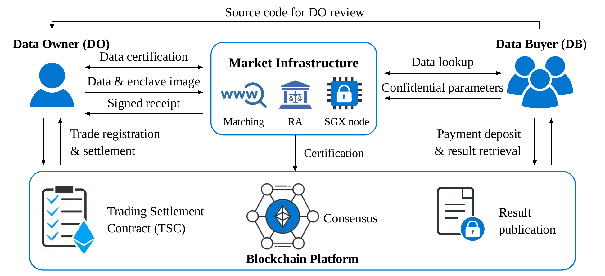

# Certified Data-Processing Trading

In the data-processing-as-a-service paradigm, a data buyer purchases the output of an agreed analysis program executed over a data owner's private dataset rather than the raw data itself. Existing TEE- and blockchain-based schemes leave two key gaps: repeated data auditing creates redundant overhead and unnecessary sample disclosure across trades, and settlement paths can decouple on-chain payment from guaranteed delivery of results computed over the certified dataset version.

This repository implements a blockchain- and Intel SGX-based certified data-processing trading protocol. A data owner binds individual records, their ordering, and independent random salts into a compact Merkle dataset commitment, which a review authority certifies via sampling so the certificate can be reused across subsequent trades. During each trade, an attested enclave reconstructs the actual input commitment, runs the agreed analysis over authenticated encrypted inputs, and returns a signed execution receipt with an encrypted result; the trading smart contract verifies the receipt, publishes the complete result ciphertext on chain, and credits payment atomically.

## System Model

<figure>
  <p align="center">
    
  </p>
  <p align="center">Figure 1: System model</p>
</figure>

The system involves the following entities:

- **Data Owner (DO):** constructs the salted Merkle commitment for a dataset version, answers sampling audit challenges, registers trades referencing an active certificate, delivers the encrypted dataset over an authenticated channel, and submits the signed execution receipt for on-chain settlement.
- **Data Buyer (DB):** verifies trade terms and deposits funds on chain, verifies the enclave attestation report and binds the receipt verification key on chain, submits confidential analysis parameters and a result encryption key to the enclave, and decrypts the settled result published by the contract.
- **Review Authority (RA):** registers audit applications, issues on-chain sampling challenges within a per-batch challenge budget, verifies sample membership proofs and business compliance, and issues reusable on-chain dataset certificates.
- **Trading Settlement Contract (TSC):** manages dataset audit states, reusable certificates, trade lifecycles, escrowed funds, dual-party receipt key confirmation, atomic encrypted result delivery with owner credit settlement, separate withdrawal, and timeout refunds.
- **Compute Host & Intel SGX Enclave:** executes the agreed program inside a hardware enclave; the host is untrusted and cannot forge receipts or substitute uncertified inputs. Once settled on chain, result recovery by the buyer no longer depends on host cooperation.

## What We Implement

- **Smart contract (`contracts/`):** `TSC.sol` (Solidity 0.8.24) and Foundry behavioral tests (`TSC.t.sol`) covering certification, challenge budgets, trade escrow, key confirmation, atomic settlement, withdrawal, and timeout refunds.
- **Core protocol library (`pkg/`):** salted Merkle commitments and membership proofs (`protocol`), sampling admission workflows (`admission`), attested worker server and authenticated client channels (`worker`, `platform`), Ethereum RPC client with embedded ABI (`chain`), analysis tasks (`analyzer`), and benchmark harnesses (`experiment`, `perfclock`).
- **Prototype CLI & enclave (`prototype/`):** unified actor CLI (`prototype/client`), execution server (`prototype/enclave`), reproducible build driver (`prototype/build.py`), test runner (`prototype/test.sh`), local end-to-end demo (`prototype/demo.py`), and SGX hardware smoke check (`prototype/sgx_smoke.sh`).
- **End-to-end integration tests (`integration/`):** Anvil-backed tests verifying complete protocol flows, late-settlement rejection, pruned-history result recovery, challenge persistence, and gas harness verification.
- **Paper evaluation modules (`6.3-certification/`, `6.4-execution/`, `6.5-chain/`, `6.6-comparison/`):** benchmark drivers, dataset preparation scripts, offline verifiers, figure generators, and third-party comparison adapters (`third_party/`).

## Quick Start

No Intel SGX hardware is required to build the native prototype, run the contract and Go integration tests, or execute the local two-trade demo.

**Prerequisites:** Go `1.26.1`, Foundry (`forge` and `anvil`), and Python `3.9+` (figure-generation scripts additionally require `matplotlib`, e.g., `pip install matplotlib`).

From the repository root:

```sh
# 1. Build the native actor CLI and local execution worker
python3 prototype/build.py native

# 2. Run Solidity unit tests and Go (-race) unit + integration tests
bash prototype/test.sh

# 3. Run the local end-to-end demo (1 certification reused across 2 trades + withdrawal)
python3 prototype/demo.py
```

The lightweight `data/adult/classification/` and `data/trade-gas/` fixtures are included so `prototype/test.sh` passes out of the box. For Linux Intel SGX / EGo 1.9.0 builds, see `prototype/build.py` and `REPRODUCIBILITY.md`.

## Reproduce

| Paper Section | Scope | Entry Point |
|---|---|---|
| Setup & Methodology | Environment, datasets, timing boundaries, paper table/figure mapping | [REPRODUCIBILITY.md](REPRODUCIBILITY.md) |
| Section 6.3 | Commitment construction, sampling processing, and certification reuse | [6.3-certification/README.md](6.3-certification/README.md) |
| Section 6.4 | Enclave initialization/attestation and Native vs. SGX processing performance | [6.4-execution/README.md](6.4-execution/README.md) |
| Section 6.5 | On-chain gas costs (Osaka rules) and result-size delivery scaling | [6.5-chain/README.md](6.5-chain/README.md) |
| Section 6.6 | Controlled common-`exp` SVM comparison with PrivacyGuard and VDDPI | [6.6-comparison/README.md](6.6-comparison/README.md) |

## Paper Summary Snapshots & Artifact Archive

Lightweight summary files under [results/paper-snapshots/](results/paper-snapshots/README.md) allow direct inspection of the published table and figure values. Full raw measurement archives (observation logs, transaction receipts, and SGX hardware evidence required to re-verify raw observations and regenerate publication figures) are excluded from Git due to size and will be published via a companion GitHub Release / Zenodo archive alongside the paper (archive URL, SHA-256 checksums, and directory layout will be linked here upon release).

> **Verification scope:** `prototype/test.sh` verifies the smart contract (Foundry) and Go unit/integration tests; Python unit tests, offline archive verification, and figure regeneration are run via the per-section commands linked above. Formal Intel SGX timings (Sections 6.4 and 6.6) were recorded on an Intel Xeon SGX host using the pinned EGo 1.9.0, Intel SGX SDK 2.27, and Gramine 1.9 toolchains described in [REPRODUCIBILITY.md](REPRODUCIBILITY.md).

## License

This project is released under the [MIT License](LICENSE). Third-party sources, upstream commits, licenses, and adaptation patches used in Section 6.6 (LIBSVM 3.23, PrivacyGuard, and VDDPI) are documented in [third_party/ADAPTATION_MANIFEST.json](third_party/ADAPTATION_MANIFEST.json).
